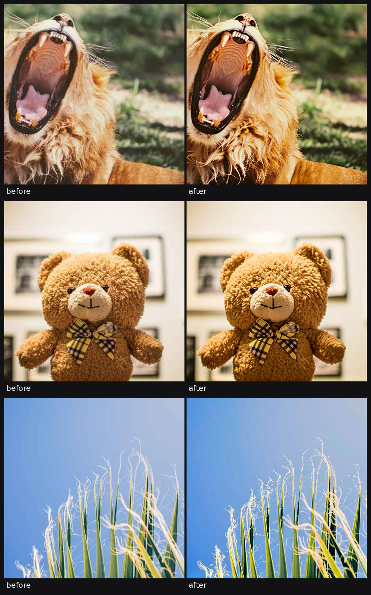

# aiuhd

Photo and video enhancer that runs on your own computer. It works without a GPU, but slowly.

```
pip install .
aiuhd photo in.jpg -o out.jpg
aiuhd video in.mp4 -o out.mp4
```

Needs Python 3.10+ and git. Video needs ffmpeg. Without a GPU, install the CPU build of PyTorch first: `pip install torch torchvision --index-url https://download.pytorch.org/whl/cpu`. Models download on first use (about 3 GB for photos), after that it works offline.

```
aiuhd photo in.jpg --scale 4                    # default is 2, above that the 2x result is resized
aiuhd photo in.jpg --face none --no-color       # detail only
aiuhd photo in.jpg --model realesrgan-x4plus    # much faster, less detail
aiuhd video in.mp4 --model realesrgan-x2plus    # better, much slower
aiuhd models                                    # fetch models ahead of time
```

<picture>
  <source media="(min-width: 768px)" srcset="demo/pairs-wide.jpg">
  
</picture>

## What it does

**Photo.** [SeedVR2](https://github.com/ByteDance-Seed/SeedVR) redraws lost detail at 2x, in overlapping tiles. Faces are then restored with GFPGAN, only where nothing covers them: an occlusion mask keeps a phone or a hand in front of the face untouched. Last, if the photo has no true black, the grey haze is taken off the dark tones and colour is given back.

**Video.** Each frame goes through a small Real-ESRGAN model. Audio is copied, frame rate and frame count stay the same, and only one frame is in memory at a time.

## Requirements

| | RAM | Time |
|---|---|---|
| photo, default | 16 GB (peaked at 9.2 GB) | 21 min for a 1450x2576 photo |
| photo, `--model realesr-general-x4v3` | 4 GB | 40 s for the same photo |
| video, default | 4 GB | under 1 frame per second for 640x360 to 1280x720 |

Measured on a Ryzen 9 7900 (12 cores) with no GPU. A GPU is picked up automatically but has not been tested.

## Limits

- Slow without a GPU. The older, faster models are compared in [bench](bench/).
- Detail is redrawn, not recovered. Small text usually survives, but it is still a guess.
- Face restoration can change how a person looks. `--face none` turns it off.
- The colour step was tuned on very few photos and acts on any photo without a true black, hazy or not. `--no-color` turns it off.
- Video is done frame by frame, so fine detail can flicker.

## Licences

The code here is MIT. Models are downloaded from their authors, not shipped: SeedVR2 (Apache 2.0, run through [numz/ComfyUI-SeedVR2_VideoUpscaler](https://github.com/numz/ComfyUI-SeedVR2_VideoUpscaler)), Real-ESRGAN (BSD 3), BSRGAN (MIT), SwinIR (Apache 2.0), GFPGAN (Apache 2.0, with some non-commercial third-party parts), RestoreFormer (Apache 2.0), YuNet (MIT), and the XSeg occlusion model from DeepFaceLab (GPL 3.0) via facefusion-assets.

## Todo

- [ ] GPU numbers
- [ ] SeedVR2 for video
- [ ] Score SeedVR2 on the test set
